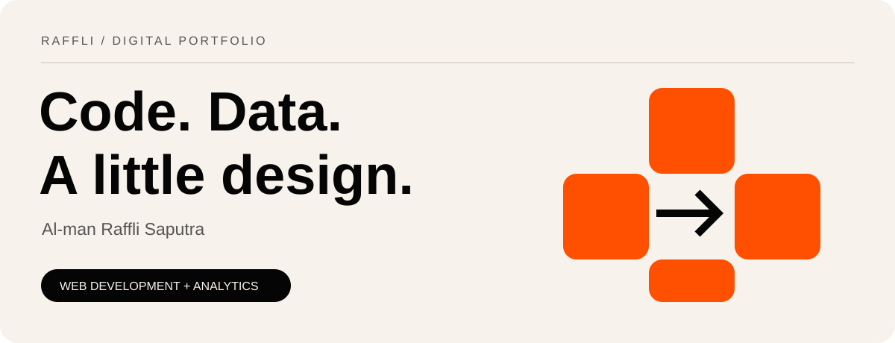

<a href="#about">About</a> &nbsp; / &nbsp; <a href="#work">Selected work</a> &nbsp; / &nbsp; <a href="#toolkit">Toolkit</a> &nbsp; / &nbsp; <a href="#journey">Journey</a> &nbsp; / &nbsp; <a href="#learning">Certificates</a> &nbsp; / &nbsp; <a href="#connect">Connect</a>

## Hello, I'm Raffli.

I turn complex needs into useful digital experiences: responsive websites, practical analytics, and clear visual communication. My work connects **web development, data analysis, graphic design, and community operations**.

Based in **Palembang, Indonesia**. A **Diploma III Computer Engineering graduate of Politeknik Negeri Sriwijaya**, with a GPA of **3.66 / 4.00** (2023–2026).

[Explore my portfolio ↗](https://raffli-dev.vercel.app) · [LinkedIn](https://www.linkedin.com/in/al-man-raffli) · [Email me](mailto:almanraffli1@gmail.com)

---

## Selected work
FROM AN IDEA TO SOMETHING YOU CAN EXPLORE.

<table>
<tr>
<td width="50%" valign="top">

<h3>KleinData</h3>

Browser-based analytics workspace with 30 SQL insight recipes, five import formats, interactive charts, and exports.

SvelteKit · Svelte 5 · TypeScript · DuckDB-Wasm

<a href="https://dataforge-analytics-neon.vercel.app/">Live project ↗</a> · <a href="https://github.com/Darren0099/DataForge">Source</a>
</td>
<td width="50%" valign="top">

<h3>Palembang Go Vacation</h3>

Tourism catalogue covering 94 destinations, with galleries, maps, and virtual tours. KMIPN VI E-Government finalist.

Next.js · React · TypeScript · CSS Modules

<a href="https://palembang-go-vacation.vercel.app/">Live project ↗</a> · <a href="https://github.com/Darren0099/KMIPN6-EGOVERNEMNT">Source</a>
</td>
</tr>
<tr>
<td width="50%" valign="top">

<h3>Youth Ranger Indonesia Sumsel</h3>

Organization profile and news CMS for Youth Ranger Indonesia South Sumatra.

Next.js · React · TypeScript · CSS Modules

<a href="https://youthrangerindonesiasumateraselatan.vercel.app/">Live project ↗</a> · <a href="https://github.com/Darren0099/YOUTHRANGERINDONESIASUMATERASELATAN">Source</a>
</td>
<td width="50%" valign="top">

<h3>Global Electronics Retailer</h3>

Multi-table analysis of global sales, product profitability, and RFM customer segmentation.

Python · Pandas · NumPy · Matplotlib

<a href="https://github.com/Darren0099/global-electronics-retailer-analysis">View analysis ↗</a>
</td>
</tr>
<tr>
<td width="50%" valign="top">

<h3>Mobius</h3>

Windows desktop island and File Studio. Source prototype in development; artwork is a branding concept.

Python · PySide6 · Qt Widgets · PyMuPDF

<a href="https://github.com/Darren0099/Mobius">Explore source ↗</a>
</td>
<td width="50%" valign="top">

<h3>PLN Iconnet Article Portal</h3>

Article management and public-facing news portal built for the PLN Icon Plus internship project.

PHP · MySQL / MariaDB · HTML · CSS

<a href="https://plniconnetbangkabelitung.ct.ws/">Live project ↗</a> · <a href="https://github.com/Darren0099/plniconnetbangkabelitung">Source</a>
</td>
</tr>
</table>

[All project case studies ↗](https://raffli-dev.vercel.app/projects) · [Graphic design archive ↗](https://raffli-dev.vercel.app/graphic-design)

---

## My toolkit

| Area | Technologies & practice |
| :--- | :--- |
| **Web & interfaces** | React · Next.js · SvelteKit · TypeScript · JavaScript · HTML · CSS · Tailwind CSS |
| **Data & analysis** | Python · Pandas · SQL · DuckDB-Wasm · Matplotlib · Seaborn · Excel · Looker Studio |
| **Applications & delivery** | PHP · MySQL · PySide6 · Git · GitHub · Vercel |
| **Visual design** | Figma · Canva · Brand identity · Design systems · Wireframing |
| **People & operations** | Volunteer coordination · Recruitment · HR programs · Community communications |

---

## The journey so far

| When | Experience | Contribution |
| :--- | :--- | :--- |
| **2026** | Graphic Designer · YRI Pusat | Content and design for Kawan YRI, Operation Division. |
| **2025** | Web Developer Intern · PLN Icon Plus Sumbagsel | Article management and public information website. |
| **2025** | HR Lead · YRI District Sumatera 2 | HR programs and volunteer coordination. |
| **2025** | Speaker · GDSC POLSRI | Study Jam on Basic CSS Animation. |
| **2025** | Research contributor · Polsri community service | Website branding and digital marketing for Kemplang Bakar Harun. |
| **2024** | Junior Full Stack Developer · YRI Sumsel | Internal organizational web applications. |
| **2024** | Web Volunteer · VALTER V | Website development and functionality testing. |
| **2023** | Head of Graphic Design · YRI Sumsel | Regional logo and visual communications. |

**Milestones:** KMIPN VI E-Government finalist (2024) · IT Fest Web Design finalist (2024) · KMIPN VII participant and project developer (2025).

---

## Learning, with a paper trail
SELECTED CERTIFICATES & A CATEGORIZED LEARNING ARCHIVE.

These cards summarize entries in my portfolio; they are custom presentation cards, not reproductions of issuer certificates. Each link below is labeled by its destination.

<table>
<tr>
<td width="50%" valign="top"> <a href="https://credmark.ai/badge/CM-2602-JSI_PT0">Credential page ↗</a></td>
<td width="50%" valign="top"> <a href="https://www.dicoding.com/certificates/6RPNYMRDRZ2M">Credential page ↗</a></td>
</tr>
<tr>
<td width="50%" valign="top"> <a href="https://www.linkedin.com/in/al-man-raffli/overlay/Certifications/459758262/treasury/?profileId=ACoAAES8EUoB9sYMOwAcjrdT5vVNOaW1yZucIGg&amp;lipi=urn%3Ali%3Apage%3Ad_flagship3_profile_view_base_certifications_details%3BQGQl1eJQS9Gm6iF1rI8rIw%3D%3D">Certificate on LinkedIn ↗</a></td>
<td width="50%" valign="top"> <a href="https://www.credly.com/org/cisco/badge/css-essentials">Issuer badge information ↗</a></td>
</tr>
<tr>
<td width="50%" valign="top"> <a href="https://www.linkedin.com/in/al-man-raffli/overlay/Certifications/679093998/treasury/?profileId=ACoAAES8EUoB9sYMOwAcjrdT5vVNOaW1yZucIGg&amp;lipi=urn%3Ali%3Apage%3Ad_flagship3_profile_view_base_certifications_details%3BtbSme3YATFGu2VYqNJdpQA%3D%3D">Certificate on LinkedIn ↗</a></td>
<td width="50%" valign="top"> <a href="https://www.linkedin.com/in/al-man-raffli/overlay/Certifications/1998697254/treasury/?profileId=ACoAAES8EUoB9sYMOwAcjrdT5vVNOaW1yZucIGg&amp;lipi=urn%3Ali%3Apage%3Ad_flagship3_profile_view_base_certifications_details%3BtbSme3YATFGu2VYqNJdpQA%3D%3D">Certificate on LinkedIn ↗</a></td>
</tr>
</table>

<strong>Web development & frontend</strong>

| Certificate / recognition | Issuer | Evidence |
| :--- | :--- | :--- |
| CSS Essentials | Cisco Networking Academy | [Issuer information](https://www.credly.com/org/cisco/badge/css-essentials) |
| PHP Level 3 Certification (Top 50%) | CredMark | [Credential](https://credmark.ai/badge/CM-2602-JSI_PT0) |
| Belajar Back-End Pemula dengan JavaScript | Dicoding Indonesia | [Credential](https://www.dicoding.com/certificates/6RPNYMRDRZ2M) |
| Belajar Dasar Pemrograman JavaScript | Dicoding Indonesia | [Credential](https://www.dicoding.com/certificates/QLZ9VWEK7X5D) |
| Short Class Software Engineering: Frontend Development | MySkill | [LinkedIn record](https://www.linkedin.com/in/al-man-raffli/overlay/Certifications/280076518/treasury?profileId=ACoAAES8EUoB9sYMOwAcjrdT5vVNOaW1yZucIGg) |
| Finalis KMIPN VI Kategori E-Government (Palembang Go Vacation!) | Politeknik Negeri Jakarta | [LinkedIn record](https://www.linkedin.com/in/al-man-raffli/overlay/Position/2436206185/treasury/?profileId=ACoAAES8EUoB9sYMOwAcjrdT5vVNOaW1yZucIGg) |
| Volunteer Festival Multimedia dan Komputer VALTER V | HMJ Teknik Komputer PolSRI | [LinkedIn record](https://www.linkedin.com/in/al-man-raffli/overlay/Position/2576979919/treasury/?profileId=ACoAAES8EUoB9sYMOwAcjrdT5vVNOaW1yZucIGg) |
| Study Jam FrontEnd Developer: Basic CSS Animation | GDSC | [LinkedIn record](https://www.linkedin.com/in/al-man-raffli/overlay/Position/2576979859/treasury/?profileId=ACoAAES8EUoB9sYMOwAcjrdT5vVNOaW1yZucIGg) |

<strong>Data analytics & AI</strong>

| Certificate / recognition | Issuer | Evidence |
| :--- | :--- | :--- |
| Data Analytics Essentials | Cisco Networking Academy | [Issuer information](https://www.credly.com/org/cisco/badge/data-analytics-essentials) |
| Bootcamp Data Analyst (Excel, SQL, Python, & Looker Studio) | KarirNex | [LinkedIn record](https://www.linkedin.com/in/al-man-raffli/overlay/Certifications/459758262/treasury/?profileId=ACoAAES8EUoB9sYMOwAcjrdT5vVNOaW1yZucIGg) |
| Intro to Data Analyst | RevoU | [LinkedIn record](https://www.linkedin.com/in/al-man-raffli/overlay/Certifications/1925145695/treasury/?profileId=ACoAAES8EUoB9sYMOwAcjrdT5vVNOaW1yZucIGg) |
| Data Science in Marketing: Customer Segmentation | DQLab | [LinkedIn record](https://www.linkedin.com/in/al-man-raffli/overlay/Certifications/1158549083/treasury?profileId=ACoAAES8EUoB9sYMOwAcjrdT5vVNOaW1yZucIGg) |
| R for Data Professional - Part 1 & 2 | DQLab | [LinkedIn record](https://www.linkedin.com/in/al-man-raffli/overlay/Certifications/1153787998/treasury/?profileId=ACoAAES8EUoB9sYMOwAcjrdT5vVNOaW1yZucIGg) |
| Introduction to Data Science with R & R Fundamental | DQLab | [LinkedIn record](https://www.linkedin.com/in/al-man-raffli/overlay/Certifications/1153741033/treasury/?profileId=ACoAAES8EUoB9sYMOwAcjrdT5vVNOaW1yZucIGg) |
| Guide to Learn R with AI at DQLab | DQLab | [LinkedIn record](https://www.linkedin.com/in/al-man-raffli/overlay/Certifications/1153620217/treasury/?profileId=ACoAAES8EUoB9sYMOwAcjrdT5vVNOaW1yZucIGg) |
| Short Class Data for Business: Data Science Introduction | MySkill | [LinkedIn record](https://www.linkedin.com/in/al-man-raffli/overlay/Certifications/1999115737/treasury/?profileId=ACoAAES8EUoB9sYMOwAcjrdT5vVNOaW1yZucIGg) |
| Intensive Bootcamp Data Analysis: Python Introduction | MySkill | [LinkedIn record](https://www.linkedin.com/in/al-man-raffli/overlay/Certifications/1644956411/treasury/?profileId=ACoAAES8EUoB9sYMOwAcjrdT5vVNOaW1yZucIGg) |
| Microsoft Excel: Vlookup, Hlookup, Index Match & Pivot Table | MySkill | [LinkedIn record](https://www.linkedin.com/in/al-man-raffli/overlay/Certifications/855897715/treasury/?profileId=ACoAAES8EUoB9sYMOwAcjrdT5vVNOaW1yZucIGg) |
| Belajar Dasar AI | Dicoding Indonesia | [Credential](https://www.dicoding.com/certificates/6RPNYM6YQZ2M) |
| AI and Career Empowerment | University of Maryland | [LinkedIn record](https://www.linkedin.com/in/al-man-raffli/overlay/Certifications/392830120/treasury/?profileId=ACoAAES8EUoB9sYMOwAcjrdT5vVNOaW1yZucIGg) |

<strong>Networks, IT & cyber security</strong>

| Certificate / recognition | Issuer | Evidence |
| :--- | :--- | :--- |
| IT Customer Support Basics | Cisco Networking Academy | [Issuer information](https://www.credly.com/org/cisco/badge/it-customer-support-basics) |
| Networking Basics | Cisco Networking Academy | [Issuer information](https://www.credly.com/org/cisco/badge/networking-basics) |
| Cyber Defence Strategies | IT Masters (CSU) | [LinkedIn record](https://www.linkedin.com/in/al-man-raffli/overlay/Certifications/679093998/treasury/?profileId=ACoAAES8EUoB9sYMOwAcjrdT5vVNOaW1yZucIGg) |
| Hacking Countermeasures 2026 | Charles Sturt Univ | [LinkedIn record](https://www.linkedin.com/in/al-man-raffli/overlay/Certifications/481753599/treasury/?profileId=ACoAAES8EUoB9sYMOwAcjrdT5vVNOaW1yZucIGg) |
| Networking Certification Essentials | Charles Sturt Univ | [LinkedIn record](https://www.linkedin.com/in/al-man-raffli/overlay/Certifications/330178347/treasury/?profileId=ACoAAES8EUoB9sYMOwAcjrdT5vVNOaW1yZucIGg) |

<strong>Cloud computing</strong>

| Certificate / recognition | Issuer | Evidence |
| :--- | :--- | :--- |
| Cloud Practitioner Essentials (Belajar Dasar AWS Cloud) | Dicoding Indonesia | [Credential](https://www.dicoding.com/certificates/KEXLYOW40ZG2) |

<strong>Design & visual communication</strong>

| Certificate / recognition | Issuer | Evidence |
| :--- | :--- | :--- |
| Short Class Graphic Design: Brand Identity | MySkill | [LinkedIn record](https://www.linkedin.com/in/al-man-raffli/overlay/Certifications/1891225986/treasury/?profileId=ACoAAES8EUoB9sYMOwAcjrdT5vVNOaW1yZucIGg) |
| Short Class UI/UX Design: Design System & Wireframing | MySkill | [LinkedIn record](https://www.linkedin.com/in/al-man-raffli/overlay/Certifications/1998697254/treasury/?profileId=ACoAAES8EUoB9sYMOwAcjrdT5vVNOaW1yZucIGg) |
| Short Class UI/UX Research Design: UX Writing Fundamental | MySkill | [LinkedIn record](https://www.linkedin.com/in/al-man-raffli/overlay/Certifications/1645053781/treasury/?profileId=ACoAAES8EUoB9sYMOwAcjrdT5vVNOaW1yZucIGg) |
| Head of Self Development and Design Division at YRI FEST X EXPO 2024 | Youth Ranger Indonesia | [LinkedIn record](https://www.linkedin.com/in/al-man-raffli/overlay/Position/2451880493/treasury/?profileId=ACoAAES8EUoB9sYMOwAcjrdT5vVNOaW1yZucIGg) |
| Achievement in Graphic Design – One Year of Excellence YRI Sumsel | Youth Ranger Indonesia | [LinkedIn record](https://www.linkedin.com/in/al-man-raffli/overlay/Position/2583114121/treasury/?profileId=ACoAAES8EUoB9sYMOwAcjrdT5vVNOaW1yZucIGg) |

<strong>People & HR</strong>

| Certificate / recognition | Issuer | Evidence |
| :--- | :--- | :--- |
| Human Resource at YRI District 2 Batch II | Youth Ranger Indonesia | [LinkedIn record](https://www.linkedin.com/in/al-man-raffli/overlay/Certifications/2029911844/treasury/?profileId=ACoAAES8EUoB9sYMOwAcjrdT5vVNOaW1yZucIGg) |
| Intensive Bootcamp Human Resource: Understanding HR Value Chain | MySkill x Deloitte | [LinkedIn record](https://www.linkedin.com/in/al-man-raffli/overlay/Certifications/1169304994/treasury/?profileId=ACoAAES8EUoB9sYMOwAcjrdT5vVNOaW1yZucIGg) |

Cisco links currently lead to issuer badge descriptions, not personal verification pages. LinkedIn records may require sign-in. The archive includes courses, certifications, and participation or achievement records.

[Explore the portfolio ↗](https://raffli-dev.vercel.app) · [LinkedIn certificates ↗](https://www.linkedin.com/in/al-man-raffli/details/certifications/)

---

## Let's build the next thing.

A useful website. A clearer dashboard. A visual identity with purpose.

**[Portfolio ↗](https://raffli-dev.vercel.app) &nbsp; · &nbsp; [LinkedIn ↗](https://www.linkedin.com/in/al-man-raffli) &nbsp; · &nbsp; [Email ↗](mailto:almanraffli1@gmail.com)**

AL-MAN RAFFLI SAPUTRA / PALEMBANG, INDONESIA
