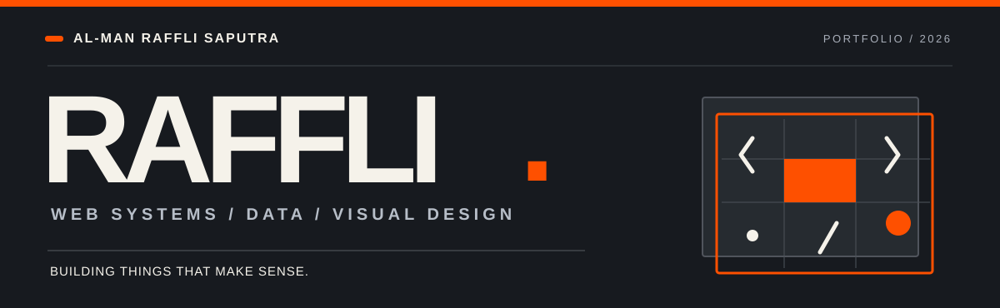
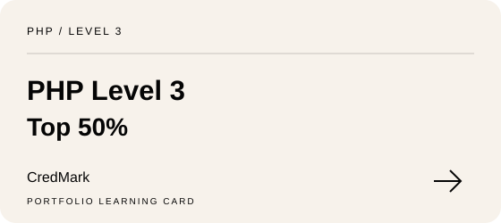
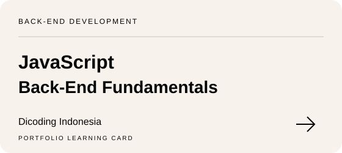
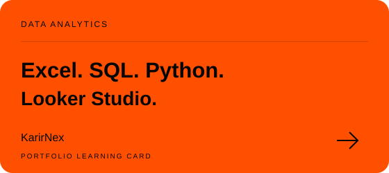
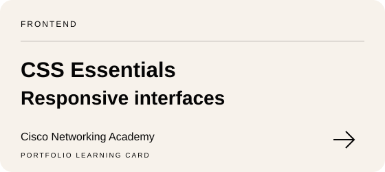
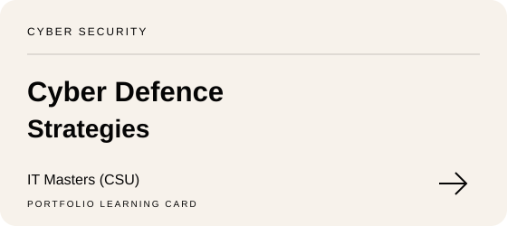
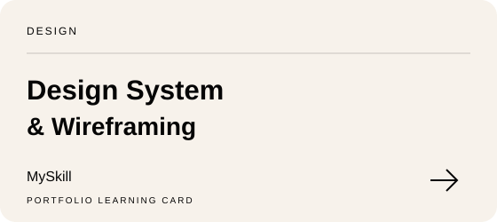

  

<table>
<tr>
<td width="24%" align="center" valign="middle">
  
</td>
<td width="76%" valign="middle">
  DEVELOPER NOTES / FROM PALEMBANG, INDONESIA
  <h2>Hi, I'm Al-Man Raffli Saputra.</h2>
  
I turn ideas into usable <strong>web products</strong>—and use data and visual thinking to make them clearer.

  
Frontend-leaning developer · Data explorer · Visual problem solver. Diploma III Computer Engineering, <strong>Politeknik Negeri Sriwijaya</strong> · GPA <strong>3.66/4.00</strong>.

  
<a href="https://raffli-dev.vercel.app/">Portfolio ↗</a> &nbsp;·&nbsp; <a href="https://rafflidev.my.id/cv">See CV ↗</a> &nbsp;·&nbsp; <a href="https://www.linkedin.com/in/al-man-raffli">LinkedIn ↗</a>

</td>
</tr>
</table>

**Browse the notes:** [Work](#work) · [Tools](#toolkit) · [Development log](#journey) · [Credentials](#learning) · [GitHub activity](#analytics) · [Contact](#connect)

---

### What I like building

I enjoy building software that is **easy to navigate, practical to maintain, and useful to someone**. That includes publishing systems for teams, public-facing web experiences, interactive dashboards, and experiments that turn messy information into something readable.

My favorite part is connecting the details: a clean interface, sensible data flow, and the person using it.

## In the making — four case files

NOT A GALLERY OF MOCKUPS. EACH PROJECT LINKS TO WORK YOU CAN EXPLORE.

<table>
<tr>
<td width="36%" valign="middle">
  
</td>
<td width="64%" valign="middle">
  01 / ANALYTICS PRODUCT
  <h3>KleinData</h3>
  
A self-service analytics workspace for exploring uploaded datasets—<strong>30 SQL insight recipes</strong>, five import formats, interactive charts, and exports.

  
SvelteKit · TypeScript · DuckDB-Wasm · Chart.js

  <a href="https://dataforge-analytics-neon.vercel.app/">Explore the app ↗</a> &nbsp;·&nbsp; <a href="https://github.com/Darren0099/DataForge">Source code</a>
</td>
</tr>
</table>

<table>
<tr>
<td width="36%" valign="middle">
  
</td>
<td width="64%" valign="middle">
  02 / PUBLIC INFORMATION · KMIPN VI FINALIST
  <h3>Palembang Go Vacation</h3>
  
A tourism portal bringing together <strong>94 destinations</strong>, category browsing, galleries, map links, and supported virtual tours. Developed for the KMIPN VI E-Government competition.

  
Next.js · React · TypeScript · CSS Modules

  <a href="https://palembang-go-vacation.vercel.app/">View website ↗</a> &nbsp;·&nbsp; <a href="https://github.com/Darren0099/KMIPN6-EGOVERNEMNT">Source code</a>
</td>
</tr>
</table>

<table>
<tr>
<td width="36%" valign="middle">
  
</td>
<td width="64%" valign="middle">
  03 / ORGANIZATION PLATFORM
  <h3>Youth Ranger Indonesia Sumsel</h3>
  
An organization site with program pages, a news and article workflow, photo galleries, and an administration interface. Content updates use the GitHub API.

  
Next.js · React · TypeScript · GitHub API

  <a href="https://youthrangerindonesiasumateraselatan.vercel.app/">View website ↗</a> &nbsp;·&nbsp; <a href="https://github.com/Darren0099/YOUTHRANGERINDONESIASUMATERASELATAN">Source code</a>
</td>
</tr>
</table>

<table>
<tr>
<td width="36%" valign="middle">
  
</td>
<td width="64%" valign="middle">
  04 / DATA EXPLORATION
  <h3>Global Electronics Retailer</h3>
  
A reproducible multi-table data analysis looking at sales, product profitability, and <strong>RFM customer segmentation</strong> with clearly documented assumptions.

  
Python · Pandas · NumPy · Matplotlib

  <a href="https://github.com/Darren0099/global-electronics-retailer-analysis">Read the analysis ↗</a>
</td>
</tr>
</table>

**More to explore:** [Full project library](https://raffli-dev.vercel.app/projects) · [Visual design archive](https://raffli-dev.vercel.app/graphic-design) · [GitHub repositories](https://github.com/Darren0099?tab=repositories)

---

## Tools I reach for

I move between frontend development, data, and design, so my toolkit follows the problem rather than a strict label.

  

View tools as a searchable text list

**Web & interface:** JavaScript · TypeScript · React · Next.js · SvelteKit · HTML5 · CSS3 · Tailwind CSS

**Data & application:** PHP · MySQL · SQL · DuckDB · Python · Pandas · PostgreSQL

**Tools & workflow:** Git · GitHub · Vercel · VS Code · Figma

---

## Development log

THINGS BUILT, TAUGHT, AND LEARNED ALONG THE WAY.

**2026 / Independent builds & product iteration**  
Developing KleinData and expanding an interactive Next.js portfolio with detailed project case studies. Exploring browser-based analytics, software ergonomics, and developer tooling.

**2025 / Web publishing in a real organization**  
Built a PHP/MySQL article-management application during an internship at **PLN Icon Plus Sumbagsel**, with search, content administration, and media workflows.

**2025 / Teaching, community & web experiences**  
Shared CSS animation techniques during a **GDSC POLSRI** frontend study jam. Contributed to website and digital-branding work through a Politeknik Negeri Sriwijaya community initiative.

**2024 / Team-based software projects**  
Worked on web systems with **Youth Ranger Indonesia Sumsel**, helped develop **Palembang Go Vacation** for KMIPN VI, and contributed to website activities around VALTER V.

PROJECT CONTEXT: KMIPN VI E-Government finalist (2024) · IT Fest Web Design finalist (2024) · KMIPN VII project participant (2025).

---

## Learning receipts

A few certificates I keep close to the work. Click a card to open its credential or supporting record.

<table>
<tr>
<td width="33%" valign="top">
  
</td>
<td width="33%" valign="top">
  
</td>
<td width="33%" valign="top">
  
</td>
</tr>
<tr>
<td width="33%" valign="top">
  
</td>
<td width="33%" valign="top">
  
</td>
<td width="33%" valign="top">
  
</td>
</tr>
</table>

<strong>Open the full learning archive by category</strong>

<strong>Web development & frontend</strong>

| Certificate / recognition | Issuer | Evidence |
| :--- | :--- | :--- |
| CSS Essentials | Cisco Networking Academy | [Issuer information](https://www.credly.com/org/cisco/badge/css-essentials) |
| PHP Level 3 Certification (Top 50%) | CredMark | [Credential](https://credmark.ai/badge/CM-2602-JSI_PT0) |
| Belajar Back-End Pemula dengan JavaScript | Dicoding Indonesia | [Credential](https://www.dicoding.com/certificates/6RPNYMRDRZ2M) |
| Belajar Dasar Pemrograman JavaScript | Dicoding Indonesia | [Credential](https://www.dicoding.com/certificates/QLZ9VWEK7X5D) |
| Short Class Software Engineering: Frontend Development | MySkill | [LinkedIn record](https://www.linkedin.com/in/al-man-raffli/overlay/Certifications/280076518/treasury?profileId=ACoAAES8EUoB9sYMOwAcjrdT5vVNOaW1yZucIGg) |
| Finalis KMIPN VI Kategori E-Government (Palembang Go Vacation!) | Politeknik Negeri Jakarta | [LinkedIn record](https://www.linkedin.com/in/al-man-raffli/overlay/Position/2436206185/treasury/?profileId=ACoAAES8EUoB9sYMOwAcjrdT5vVNOaW1yZucIGg) |
| Volunteer Festival Multimedia dan Komputer VALTER V | HMJ Teknik Komputer PolSRI | [LinkedIn record](https://www.linkedin.com/in/al-man-raffli/overlay/Position/2576979919/treasury/?profileId=ACoAAES8EUoB9sYMOwAcjrdT5vVNOaW1yZucIGg) |
| Study Jam FrontEnd Developer: Basic CSS Animation | GDSC | [LinkedIn record](https://www.linkedin.com/in/al-man-raffli/overlay/Position/2576979859/treasury/?profileId=ACoAAES8EUoB9sYMOwAcjrdT5vVNOaW1yZucIGg) |

<strong>Data analytics & AI</strong>

| Certificate / recognition | Issuer | Evidence |
| :--- | :--- | :--- |
| Data Analytics Essentials | Cisco Networking Academy | [Issuer information](https://www.credly.com/org/cisco/badge/data-analytics-essentials) |
| Bootcamp Data Analyst (Excel, SQL, Python, & Looker Studio) | KarirNex | [LinkedIn record](https://www.linkedin.com/in/al-man-raffli/overlay/Certifications/459758262/treasury/?profileId=ACoAAES8EUoB9sYMOwAcjrdT5vVNOaW1yZucIGg) |
| Intro to Data Analyst | RevoU | [LinkedIn record](https://www.linkedin.com/in/al-man-raffli/overlay/Certifications/1925145695/treasury/?profileId=ACoAAES8EUoB9sYMOwAcjrdT5vVNOaW1yZucIGg) |
| Data Science in Marketing: Customer Segmentation | DQLab | [LinkedIn record](https://www.linkedin.com/in/al-man-raffli/overlay/Certifications/1158549083/treasury?profileId=ACoAAES8EUoB9sYMOwAcjrdT5vVNOaW1yZucIGg) |
| R for Data Professional - Part 1 & 2 | DQLab | [LinkedIn record](https://www.linkedin.com/in/al-man-raffli/overlay/Certifications/1153787998/treasury/?profileId=ACoAAES8EUoB9sYMOwAcjrdT5vVNOaW1yZucIGg) |
| Introduction to Data Science with R & R Fundamental | DQLab | [LinkedIn record](https://www.linkedin.com/in/al-man-raffli/overlay/Certifications/1153741033/treasury/?profileId=ACoAAES8EUoB9sYMOwAcjrdT5vVNOaW1yZucIGg) |
| Guide to Learn R with AI at DQLab | DQLab | [LinkedIn record](https://www.linkedin.com/in/al-man-raffli/overlay/Certifications/1153620217/treasury/?profileId=ACoAAES8EUoB9sYMOwAcjrdT5vVNOaW1yZucIGg) |
| Short Class Data for Business: Data Science Introduction | MySkill | [LinkedIn record](https://www.linkedin.com/in/al-man-raffli/overlay/Certifications/1999115737/treasury/?profileId=ACoAAES8EUoB9sYMOwAcjrdT5vVNOaW1yZucIGg) |
| Intensive Bootcamp Data Analysis: Python Introduction | MySkill | [LinkedIn record](https://www.linkedin.com/in/al-man-raffli/overlay/Certifications/1644956411/treasury/?profileId=ACoAAES8EUoB9sYMOwAcjrdT5vVNOaW1yZucIGg) |
| Microsoft Excel: Vlookup, Hlookup, Index Match & Pivot Table | MySkill | [LinkedIn record](https://www.linkedin.com/in/al-man-raffli/overlay/Certifications/855897715/treasury/?profileId=ACoAAES8EUoB9sYMOwAcjrdT5vVNOaW1yZucIGg) |
| Belajar Dasar AI | Dicoding Indonesia | [Credential](https://www.dicoding.com/certificates/6RPNYM6YQZ2M) |
| AI and Career Empowerment | University of Maryland | [LinkedIn record](https://www.linkedin.com/in/al-man-raffli/overlay/Certifications/392830120/treasury/?profileId=ACoAAES8EUoB9sYMOwAcjrdT5vVNOaW1yZucIGg) |

<strong>Networks, IT & cyber security</strong>

| Certificate / recognition | Issuer | Evidence |
| :--- | :--- | :--- |
| IT Customer Support Basics | Cisco Networking Academy | [Issuer information](https://www.credly.com/org/cisco/badge/it-customer-support-basics) |
| Networking Basics | Cisco Networking Academy | [Issuer information](https://www.credly.com/org/cisco/badge/networking-basics) |
| Cyber Defence Strategies | IT Masters (CSU) | [LinkedIn record](https://www.linkedin.com/in/al-man-raffli/overlay/Certifications/679093998/treasury/?profileId=ACoAAES8EUoB9sYMOwAcjrdT5vVNOaW1yZucIGg) |
| Hacking Countermeasures 2026 | Charles Sturt Univ | [LinkedIn record](https://www.linkedin.com/in/al-man-raffli/overlay/Certifications/481753599/treasury/?profileId=ACoAAES8EUoB9sYMOwAcjrdT5vVNOaW1yZucIGg) |
| Networking Certification Essentials | Charles Sturt Univ | [LinkedIn record](https://www.linkedin.com/in/al-man-raffli/overlay/Certifications/330178347/treasury/?profileId=ACoAAES8EUoB9sYMOwAcjrdT5vVNOaW1yZucIGg) |

<strong>Cloud computing</strong>

| Certificate / recognition | Issuer | Evidence |
| :--- | :--- | :--- |
| Cloud Practitioner Essentials (Belajar Dasar AWS Cloud) | Dicoding Indonesia | [Credential](https://www.dicoding.com/certificates/KEXLYOW40ZG2) |

<strong>Design & visual communication</strong>

| Certificate / recognition | Issuer | Evidence |
| :--- | :--- | :--- |
| Short Class Graphic Design: Brand Identity | MySkill | [LinkedIn record](https://www.linkedin.com/in/al-man-raffli/overlay/Certifications/1891225986/treasury/?profileId=ACoAAES8EUoB9sYMOwAcjrdT5vVNOaW1yZucIGg) |
| Short Class UI/UX Design: Design System & Wireframing | MySkill | [LinkedIn record](https://www.linkedin.com/in/al-man-raffli/overlay/Certifications/1998697254/treasury/?profileId=ACoAAES8EUoB9sYMOwAcjrdT5vVNOaW1yZucIGg) |
| Short Class UI/UX Research Design: UX Writing Fundamental | MySkill | [LinkedIn record](https://www.linkedin.com/in/al-man-raffli/overlay/Certifications/1645053781/treasury/?profileId=ACoAAES8EUoB9sYMOwAcjrdT5vVNOaW1yZucIGg) |
| Head of Self Development and Design Division at YRI FEST X EXPO 2024 | Youth Ranger Indonesia | [LinkedIn record](https://www.linkedin.com/in/al-man-raffli/overlay/Position/2451880493/treasury/?profileId=ACoAAES8EUoB9sYMOwAcjrdT5vVNOaW1yZucIGg) |
| Achievement in Graphic Design – One Year of Excellence YRI Sumsel | Youth Ranger Indonesia | [LinkedIn record](https://www.linkedin.com/in/al-man-raffli/overlay/Position/2583114121/treasury/?profileId=ACoAAES8EUoB9sYMOwAcjrdT5vVNOaW1yZucIGg) |

<strong>People & HR</strong>

| Certificate / recognition | Issuer | Evidence |
| :--- | :--- | :--- |
| Human Resource at YRI District 2 Batch II | Youth Ranger Indonesia | [LinkedIn record](https://www.linkedin.com/in/al-man-raffli/overlay/Certifications/2029911844/treasury/?profileId=ACoAAES8EUoB9sYMOwAcjrdT5vVNOaW1yZucIGg) |
| Intensive Bootcamp Human Resource: Understanding HR Value Chain | MySkill x Deloitte | [LinkedIn record](https://www.linkedin.com/in/al-man-raffli/overlay/Certifications/1169304994/treasury/?profileId=ACoAAES8EUoB9sYMOwAcjrdT5vVNOaW1yZucIGg) |

Cisco links currently lead to issuer badge descriptions, not personal verification pages. LinkedIn records may require sign-in. The archive includes courses, certifications, and participation or achievement records.

---

## GitHub analytics

PUBLIC REPOSITORIES · LANGUAGES · CONTRIBUTION ACTIVITY

Total Contributions, current streak, and longest streak are generated dynamically from available GitHub contribution data. Numbers may update as activity is indexed.

---

## Have an idea worth building?

A useful website, a clearer dashboard, or a visual identity that makes sense—I'm open to a conversation.

  &nbsp;
  &nbsp;
  &nbsp;
  &nbsp;
  

RAFFLI / PALEMBANG, INDONESIA · BUILT WITH CURIOSITY, REVISED WITH INTENTION.
