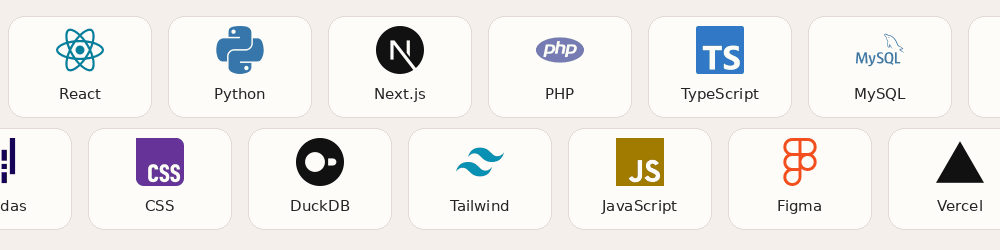

<table>
<tr>
<td width="64%" valign="middle">
AL-MAN RAFFLI SAPUTRA / DIGITAL PORTFOLIO
<h1>Code. Data. A little design.</h1>

Building useful digital experiences with code, curiosity, and thoughtful interfaces.

<strong>Web Developer · Data Analyst</strong> Palembang, Indonesia

</td>
<td width="36%" valign="middle" align="center">

</td>
</tr>
</table>

<a href="#about">About</a> &nbsp; / &nbsp; <a href="#work">Selected work</a> &nbsp; / &nbsp; <a href="#toolkit">Toolkit</a> &nbsp; / &nbsp; <a href="#journey">Journey</a> &nbsp; / &nbsp; <a href="#learning">Certificates</a> &nbsp; / &nbsp; <a href="#analytics">Analytics</a> &nbsp; / &nbsp; <a href="#connect">Connect</a>

## Hello, I'm Raffli.

I turn complex needs into useful digital experiences: responsive websites, practical analytics, and clear visual communication. My work connects **web development, data analysis, graphic design, and community operations**.

Based in **Palembang, Indonesia**. A **Diploma III Computer Engineering graduate of Politeknik Negeri Sriwijaya**, with a GPA of **3.66 / 4.00** (2023–2026).

[Explore my portfolio ↗](https://raffli-dev.vercel.app) · [LinkedIn](https://www.linkedin.com/in/al-man-raffli) · [Email me](mailto:almanraffli1@gmail.com)

---

## Selected work
FROM AN IDEA TO SOMETHING YOU CAN EXPLORE.

<table>
<tr>
<td width="50%" valign="top">

<h3>KleinData</h3>

Browser-based analytics workspace with 30 SQL insight recipes, five import formats, interactive charts, and exports.

SvelteKit · Svelte 5 · TypeScript · DuckDB-Wasm

<a href="https://dataforge-analytics-neon.vercel.app/">Live project ↗</a> · <a href="https://github.com/Darren0099/DataForge">Source</a>
</td>
<td width="50%" valign="top">

<h3>Palembang Go Vacation</h3>

Tourism catalogue covering 94 destinations, with galleries, maps, and virtual tours. KMIPN VI E-Government finalist.

Next.js · React · TypeScript · CSS Modules

<a href="https://palembang-go-vacation.vercel.app/">Live project ↗</a> · <a href="https://github.com/Darren0099/KMIPN6-EGOVERNEMNT">Source</a>
</td>
</tr>
<tr>
<td width="50%" valign="top">

<h3>Youth Ranger Indonesia Sumsel</h3>

Organization profile and news CMS for Youth Ranger Indonesia South Sumatra.

Next.js · React · TypeScript · CSS Modules

<a href="https://youthrangerindonesiasumateraselatan.vercel.app/">Live project ↗</a> · <a href="https://github.com/Darren0099/YOUTHRANGERINDONESIASUMATERASELATAN">Source</a>
</td>
<td width="50%" valign="top">

<h3>Global Electronics Retailer</h3>

Multi-table analysis of global sales, product profitability, and RFM customer segmentation.

Python · Pandas · NumPy · Matplotlib

<a href="https://github.com/Darren0099/global-electronics-retailer-analysis">View analysis ↗</a>
</td>
</tr>
</table>

[All project case studies ↗](https://raffli-dev.vercel.app/projects) · [Graphic design archive ↗](https://raffli-dev.vercel.app/graphic-design)

---

03 / TECHNICAL EXPERTISE

## My toolkit

View tools as text

React · Python · Next.js · PHP · TypeScript · MySQL · Svelte · Git · HTML5 · Pandas · CSS · DuckDB · Tailwind CSS · JavaScript · Figma · Vercel

---

## The journey so far

| When | Experience | Contribution |
| :--- | :--- | :--- |
| **2025** | Web Developer Intern · PLN Icon Plus Sumbagsel | Article management and public information website. |
| **2025** | Speaker · GDSC POLSRI | Study Jam on Basic CSS Animation. |
| **2025** | Research contributor · Polsri community service | Developed the branding website for Kemplang Bakar Harun. |
| **2024** | Junior Full Stack Developer · YRI Sumsel | Internal organizational web applications. |
| **2024** | Web Volunteer · VALTER V | Website development and functionality testing. |

**Milestones:** KMIPN VI E-Government finalist (2024) · IT Fest Web Design finalist (2024) · KMIPN VII participant and project developer (2025).

---

## Learning, with a paper trail
SELECTED CERTIFICATES & A CATEGORIZED LEARNING ARCHIVE.

Selected learning highlights. Click a card to open its credential or supporting record.

<table>
<tr>
<td width="50%" valign="top"></td>
<td width="50%" valign="top"></td>
</tr>
<tr>
<td width="50%" valign="top"></td>
<td width="50%" valign="top"></td>
</tr>
<tr>
<td width="50%" valign="top"></td>
<td width="50%" valign="top"></td>
</tr>
</table>

<strong>Web development & frontend</strong>

| Certificate / recognition | Issuer | Evidence |
| :--- | :--- | :--- |
| CSS Essentials | Cisco Networking Academy | [Issuer information](https://www.credly.com/org/cisco/badge/css-essentials) |
| PHP Level 3 Certification (Top 50%) | CredMark | [Credential](https://credmark.ai/badge/CM-2602-JSI_PT0) |
| Belajar Back-End Pemula dengan JavaScript | Dicoding Indonesia | [Credential](https://www.dicoding.com/certificates/6RPNYMRDRZ2M) |
| Belajar Dasar Pemrograman JavaScript | Dicoding Indonesia | [Credential](https://www.dicoding.com/certificates/QLZ9VWEK7X5D) |
| Short Class Software Engineering: Frontend Development | MySkill | [LinkedIn record](https://www.linkedin.com/in/al-man-raffli/overlay/Certifications/280076518/treasury?profileId=ACoAAES8EUoB9sYMOwAcjrdT5vVNOaW1yZucIGg) |
| Finalis KMIPN VI Kategori E-Government (Palembang Go Vacation!) | Politeknik Negeri Jakarta | [LinkedIn record](https://www.linkedin.com/in/al-man-raffli/overlay/Position/2436206185/treasury/?profileId=ACoAAES8EUoB9sYMOwAcjrdT5vVNOaW1yZucIGg) |
| Volunteer Festival Multimedia dan Komputer VALTER V | HMJ Teknik Komputer PolSRI | [LinkedIn record](https://www.linkedin.com/in/al-man-raffli/overlay/Position/2576979919/treasury/?profileId=ACoAAES8EUoB9sYMOwAcjrdT5vVNOaW1yZucIGg) |
| Study Jam FrontEnd Developer: Basic CSS Animation | GDSC | [LinkedIn record](https://www.linkedin.com/in/al-man-raffli/overlay/Position/2576979859/treasury/?profileId=ACoAAES8EUoB9sYMOwAcjrdT5vVNOaW1yZucIGg) |

<strong>Data analytics & AI</strong>

| Certificate / recognition | Issuer | Evidence |
| :--- | :--- | :--- |
| Data Analytics Essentials | Cisco Networking Academy | [Issuer information](https://www.credly.com/org/cisco/badge/data-analytics-essentials) |
| Bootcamp Data Analyst (Excel, SQL, Python, & Looker Studio) | KarirNex | [LinkedIn record](https://www.linkedin.com/in/al-man-raffli/overlay/Certifications/459758262/treasury/?profileId=ACoAAES8EUoB9sYMOwAcjrdT5vVNOaW1yZucIGg) |
| Intro to Data Analyst | RevoU | [LinkedIn record](https://www.linkedin.com/in/al-man-raffli/overlay/Certifications/1925145695/treasury/?profileId=ACoAAES8EUoB9sYMOwAcjrdT5vVNOaW1yZucIGg) |
| Data Science in Marketing: Customer Segmentation | DQLab | [LinkedIn record](https://www.linkedin.com/in/al-man-raffli/overlay/Certifications/1158549083/treasury?profileId=ACoAAES8EUoB9sYMOwAcjrdT5vVNOaW1yZucIGg) |
| R for Data Professional - Part 1 & 2 | DQLab | [LinkedIn record](https://www.linkedin.com/in/al-man-raffli/overlay/Certifications/1153787998/treasury/?profileId=ACoAAES8EUoB9sYMOwAcjrdT5vVNOaW1yZucIGg) |
| Introduction to Data Science with R & R Fundamental | DQLab | [LinkedIn record](https://www.linkedin.com/in/al-man-raffli/overlay/Certifications/1153741033/treasury/?profileId=ACoAAES8EUoB9sYMOwAcjrdT5vVNOaW1yZucIGg) |
| Guide to Learn R with AI at DQLab | DQLab | [LinkedIn record](https://www.linkedin.com/in/al-man-raffli/overlay/Certifications/1153620217/treasury/?profileId=ACoAAES8EUoB9sYMOwAcjrdT5vVNOaW1yZucIGg) |
| Short Class Data for Business: Data Science Introduction | MySkill | [LinkedIn record](https://www.linkedin.com/in/al-man-raffli/overlay/Certifications/1999115737/treasury/?profileId=ACoAAES8EUoB9sYMOwAcjrdT5vVNOaW1yZucIGg) |
| Intensive Bootcamp Data Analysis: Python Introduction | MySkill | [LinkedIn record](https://www.linkedin.com/in/al-man-raffli/overlay/Certifications/1644956411/treasury/?profileId=ACoAAES8EUoB9sYMOwAcjrdT5vVNOaW1yZucIGg) |
| Microsoft Excel: Vlookup, Hlookup, Index Match & Pivot Table | MySkill | [LinkedIn record](https://www.linkedin.com/in/al-man-raffli/overlay/Certifications/855897715/treasury/?profileId=ACoAAES8EUoB9sYMOwAcjrdT5vVNOaW1yZucIGg) |
| Belajar Dasar AI | Dicoding Indonesia | [Credential](https://www.dicoding.com/certificates/6RPNYM6YQZ2M) |
| AI and Career Empowerment | University of Maryland | [LinkedIn record](https://www.linkedin.com/in/al-man-raffli/overlay/Certifications/392830120/treasury/?profileId=ACoAAES8EUoB9sYMOwAcjrdT5vVNOaW1yZucIGg) |

<strong>Networks, IT & cyber security</strong>

| Certificate / recognition | Issuer | Evidence |
| :--- | :--- | :--- |
| IT Customer Support Basics | Cisco Networking Academy | [Issuer information](https://www.credly.com/org/cisco/badge/it-customer-support-basics) |
| Networking Basics | Cisco Networking Academy | [Issuer information](https://www.credly.com/org/cisco/badge/networking-basics) |
| Cyber Defence Strategies | IT Masters (CSU) | [LinkedIn record](https://www.linkedin.com/in/al-man-raffli/overlay/Certifications/679093998/treasury/?profileId=ACoAAES8EUoB9sYMOwAcjrdT5vVNOaW1yZucIGg) |
| Hacking Countermeasures 2026 | Charles Sturt Univ | [LinkedIn record](https://www.linkedin.com/in/al-man-raffli/overlay/Certifications/481753599/treasury/?profileId=ACoAAES8EUoB9sYMOwAcjrdT5vVNOaW1yZucIGg) |
| Networking Certification Essentials | Charles Sturt Univ | [LinkedIn record](https://www.linkedin.com/in/al-man-raffli/overlay/Certifications/330178347/treasury/?profileId=ACoAAES8EUoB9sYMOwAcjrdT5vVNOaW1yZucIGg) |

<strong>Cloud computing</strong>

| Certificate / recognition | Issuer | Evidence |
| :--- | :--- | :--- |
| Cloud Practitioner Essentials (Belajar Dasar AWS Cloud) | Dicoding Indonesia | [Credential](https://www.dicoding.com/certificates/KEXLYOW40ZG2) |

<strong>Design & visual communication</strong>

| Certificate / recognition | Issuer | Evidence |
| :--- | :--- | :--- |
| Short Class Graphic Design: Brand Identity | MySkill | [LinkedIn record](https://www.linkedin.com/in/al-man-raffli/overlay/Certifications/1891225986/treasury/?profileId=ACoAAES8EUoB9sYMOwAcjrdT5vVNOaW1yZucIGg) |
| Short Class UI/UX Design: Design System & Wireframing | MySkill | [LinkedIn record](https://www.linkedin.com/in/al-man-raffli/overlay/Certifications/1998697254/treasury/?profileId=ACoAAES8EUoB9sYMOwAcjrdT5vVNOaW1yZucIGg) |
| Short Class UI/UX Research Design: UX Writing Fundamental | MySkill | [LinkedIn record](https://www.linkedin.com/in/al-man-raffli/overlay/Certifications/1645053781/treasury/?profileId=ACoAAES8EUoB9sYMOwAcjrdT5vVNOaW1yZucIGg) |
| Head of Self Development and Design Division at YRI FEST X EXPO 2024 | Youth Ranger Indonesia | [LinkedIn record](https://www.linkedin.com/in/al-man-raffli/overlay/Position/2451880493/treasury/?profileId=ACoAAES8EUoB9sYMOwAcjrdT5vVNOaW1yZucIGg) |
| Achievement in Graphic Design – One Year of Excellence YRI Sumsel | Youth Ranger Indonesia | [LinkedIn record](https://www.linkedin.com/in/al-man-raffli/overlay/Position/2583114121/treasury/?profileId=ACoAAES8EUoB9sYMOwAcjrdT5vVNOaW1yZucIGg) |

<strong>People & HR</strong>

| Certificate / recognition | Issuer | Evidence |
| :--- | :--- | :--- |
| Human Resource at YRI District 2 Batch II | Youth Ranger Indonesia | [LinkedIn record](https://www.linkedin.com/in/al-man-raffli/overlay/Certifications/2029911844/treasury/?profileId=ACoAAES8EUoB9sYMOwAcjrdT5vVNOaW1yZucIGg) |
| Intensive Bootcamp Human Resource: Understanding HR Value Chain | MySkill x Deloitte | [LinkedIn record](https://www.linkedin.com/in/al-man-raffli/overlay/Certifications/1169304994/treasury/?profileId=ACoAAES8EUoB9sYMOwAcjrdT5vVNOaW1yZucIGg) |

Cisco links currently lead to issuer badge descriptions, not personal verification pages. LinkedIn records may require sign-in. The archive includes courses, certifications, and participation or achievement records.

[Explore the portfolio ↗](https://raffli-dev.vercel.app) · [LinkedIn certificates ↗](https://www.linkedin.com/in/al-man-raffli/details/certifications/)

---

## GitHub analytics

---

&nbsp;&nbsp;
&nbsp;&nbsp;
&nbsp;&nbsp;

